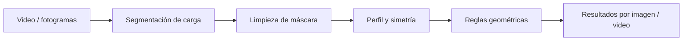

# Análisis visual del cono de carga en CAEX

[English](README.md) · [Demo](#probar-la-demo) · [Evaluación](docs/evaluacion.md) · [Documentación](docs/quickstart.md)

[](https://github.com/sebargith/Cono-de-Carga/actions/workflows/tests.yml)

Proyecto de memoria de título desarrollado en colaboración con **PSINet** para analizar la forma visible de la carga en camiones de extracción minera (CAEX). A partir de imágenes tomadas desde atrás del camión, el sistema segmenta la carga y utiliza su perfil y simetría para clasificar su orientación visual como `centrado`, `izquierda` o `derecha`. Si la máscara no permite una medición válida, devuelve `no_evaluable`.

Incluye procesamiento de videos, un analítico geométrico propio, estadísticas, exportación de resultados y una aplicación Streamlit. Busca facilitar la revisión de las cargas y seleccionar casos que merecen atención. **Describe la forma visible; no mide el centro de masa ni determina la estabilidad física del camión.**

## Ejemplo visual


*Las posiciones se calculan respecto de la propia máscara, no de una referencia externa de la tolva.*

## Resultados

Evaluación del analítico sobre **90 imágenes**, con 30 referencias por clase:

| Indicador | Resultado |
| --- | --- |
| Exactitud global | **88,89 % — 80/90** |
| Centrado: referencias correctamente identificadas | 73,33 % — 22/30 |
| Izquierda: referencias correctamente identificadas | 93,33 % — 28/30 |
| Derecha: referencias correctamente identificadas | 100 % — 30/30 |
| Imágenes evaluables en esta muestra | 100 % — 90/90 |

Los porcentajes por clase son *recall*: de las imágenes que pertenecen a esa clase, cuántas se reconocieron correctamente. Que todas fueran evaluables no significa que todas fueran correctas. Ocho de los diez errores corresponden a cargas centradas clasificadas hacia un lado.

| Referencia ↓ / Predicción → | Centrado | Izquierda | Derecha |
| --- | ---: | ---: | ---: |
| Centrado | 22 | 6 | 2 |
| Izquierda | 2 | 28 | 0 |
| Derecha | 0 | 0 | 30 |

Estos resultados describen la muestra evaluada, no el rendimiento garantizado en otras cámaras o minas. Los ajustes de sensibilidad se realizaron en varias pruebas; las 90 imágenes se utilizaron para reportar el rendimiento del analítico. [Protocolo, límites y resultados originales](docs/evaluacion.md).

## Mi participación

Desarrollé el proyecto desde la preparación de datos hasta la implementación y evaluación del sistema. Mi trabajo incluyó el etiquetado, el entrenamiento del modelo de segmentación, el diseño del analítico geométrico, el procesamiento de videos y la aplicación de visualización. Las decisiones y las etiquetas de referencia se revisaron junto al equipo de ingenieros de PSINet.

El aporte central es convertir la máscara en medidas interpretables y reglas configurables, y reunir los resultados por imagen y video. El modelo entrenado de segmentación constituye la base de percepción; no produce por sí solo la clasificación del cono.

## Cómo funciona




La geometría incluye perfil superior, ápice, simetría de área y centroide. Las reglas utilizan la posición del ápice y la simetría para clasificar; el centroide y la irregularidad quedan como apoyo. Cada resultado puede relacionarse con su imagen y sus indicadores.


*Figura ilustrativa elaborada para el informe, no una captura de una ejecución única. Los valores mostrados no constituyen un benchmark de velocidad.*

Tecnologías: Python, OpenCV, NumPy, SciPy, YOLO para segmentación, PyTorch, Streamlit, Docker y MLflow. Docker y MLflow se utilizan en entrenamiento; no son necesarios para la demo geométrica.

## Probar la demo

La demo crea cuatro máscaras sintéticas y ejecuta la limpieza, el cálculo geométrico y las reglas reales del proyecto. **No ejecuta segmentación ni reproduce la evaluación de 90 imágenes.** Usar Python 3.12:

```powershell
git clone https://github.com/sebargith/Cono-de-Carga.git
cd Cono-de-Carga
python -m venv .venv-demo
.\.venv-demo\Scripts\Activate.ps1
python -m pip install -r requirements/demo.txt
python scripts/demo_synthetic.py
python -m unittest discover -s tests -v
```

En Linux/macOS, sustituir la activación por `source .venv-demo/bin/activate`. El alcance de las comprobaciones se detalla en la [guía](docs/quickstart.md).

Se generan cuatro PNG y `results.csv` en `outputs/demo_synthetic/`, con izquierda, centrado, derecha y no evaluable. Para repetir, indicar una carpeta nueva con `--output-dir`; no se sobrescriben resultados existentes.

La [guía](docs/quickstart.md) separa demo, análisis con máscaras existentes y procesamiento de videos con el modelo. Este último necesita pesos, videos y el entorno de inferencia; las dependencias actuales utilizan CUDA.

En Windows, `Abrir web app Cono de Carga.bat` inicia la interfaz y prepara su entorno. La primera instalación puede tardar varios minutos. Más detalles en [pipeline de videos](docs/pipeline_videos_locales.md) y [entrenamiento](perception/README.md).

## Código y documentación

| Ruta | Contenido |
| --- | --- |
| `src/cone_load/` | Limpieza, perfiles, variables, reglas y visualizaciones |
| `configs/analytic_config.yaml` | Parámetros del analítico |
| `scripts/` y `tests/` | Ejecución, evaluación y pruebas |
| `web_app/` | Aplicación Streamlit |
| `perception/` | Segmentación y entrenamiento |
| `deliverables/` | Resultados e informes existentes |

[Arquitectura](docs/arquitectura_pipeline.md) · [Evaluación](docs/evaluacion.md) · [Revisión de publicación](docs/publicacion.md)

## Limitaciones y siguiente paso

- La referencia es la propia carga visible. No se estima volumen, masa ni desplazamiento físico respecto de la tolva.
- Una máscara incorrecta puede afectar las medidas. Las comprobaciones no detectan todos los errores de segmentación.
- El empate de votos por imagen favorece izquierda. Algunas contradicciones entre medianas por video también favorecen izquierda. Son comportamientos existentes, documentados y cubiertos por pruebas; no se han alterado las reglas ni los resultados publicados.
- La evaluación es por imagen: no valida por sí sola el veredicto por video ni beneficios operativos en terreno.
- Se procesan archivos locales; no se presenta como servicio en producción ni solución en tiempo real.

Próximo paso: evaluar nuevos videos y condiciones de captura, y estudiar el efecto de otras reglas de desempate antes de cambiar el analítico.

## Contexto y publicación

Desarrollado como memoria de título en colaboración con PSINet. [Granulometría visual](https://github.com/sebargith/Granulometria-Tolva) es el proyecto complementario: ambos utilizan un único modelo entrenado de segmentación, pero ejecutan ramas distintas con sus propias configuraciones. Cono describe la forma; Granulometría describe la composición superficial. Sus resultados evalúan tareas diferentes y no deben compararse como un ranking.

Los archivos de la empresa requieren autorización de difusión. La demo sintética no usa datos de la mina. [Revisión de publicación](docs/publicacion.md).
