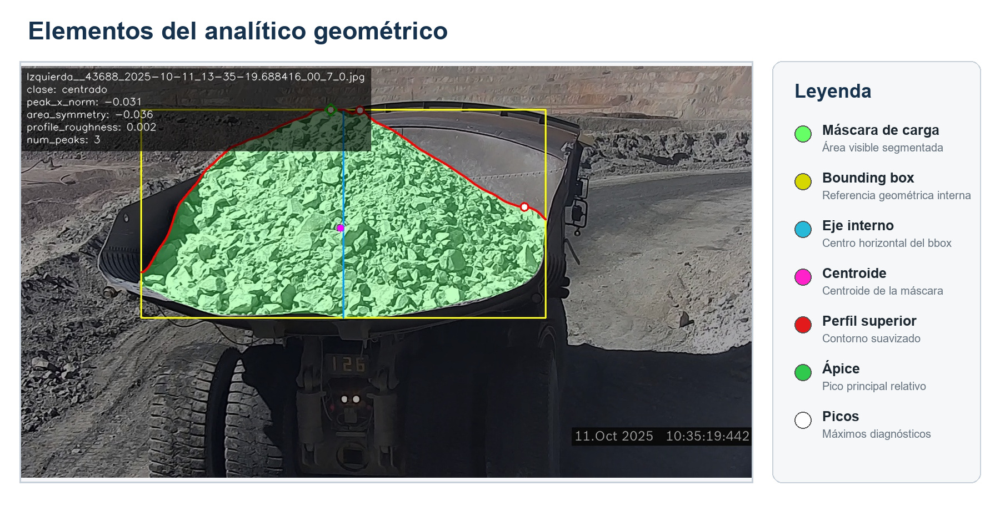
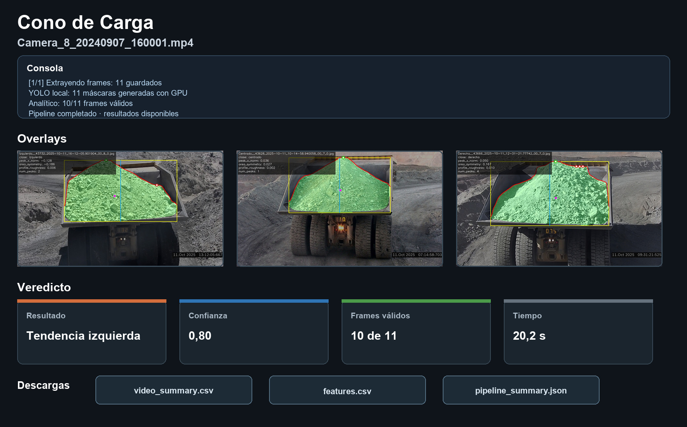

# Haul Truck Load Shape Analysis

[Español](README.es.md) · [Demo](#try-the-demo) · [Evaluation](docs/evaluacion.md) · [Documentation](docs/quickstart.md)

[](https://github.com/sebargith/Cono-de-Carga/actions/workflows/tests.yml)

Undergraduate thesis project developed with **PSINet** to analyze the visible load shape in mining haul trucks (CAEX). A trained segmentation model extracts the load from rear-view images. A custom geometric analytic uses its upper profile and area symmetry to classify the visible orientation as centered, left or right. Invalid cases receive `no_evaluable`.

The system includes local video processing, video summaries, CSV/JSON outputs and a Streamlit review application. **It does not measure the center of mass or determine physical truck stability.**

## Visual example



*Positions use the load mask itself as a reference, not an independently detected truck bed.*

## Results

Evaluation on **90 images**, with 30 references per class:

| Metric | Result |
| --- | --- |
| Overall accuracy | **88.89% — 80/90** |
| Centered recall | 73.33% — 22/30 |
| Left recall | 93.33% — 28/30 |
| Right recall | 100% — 30/30 |
| Evaluable images in this set | 100% — 90/90 |

| Reference ↓ / Prediction → | Centered | Left | Right |
| --- | ---: | ---: | ---: |
| Centered | 22 | 6 | 2 |
| Left | 2 | 28 | 0 |
| Right | 0 | 0 | 30 |

Eight of ten errors are centered examples classified toward one side. Evaluable coverage is not accuracy. Sensitivity was adjusted through several trials; the 90-image set reports analytic performance. Results do not establish generalization to other cameras or mines. [Protocol](docs/evaluacion.md) · [Original JSON](deliverables/evaluacion_tecnica_90/resumen/resumen_evaluacion.json).

## My contribution

I developed the project from data preparation through implementation and evaluation: labeling, segmentation model training, geometric feature extraction and decision rules, video processing, and the review application. Decisions and reference labels were reviewed with PSINet's engineering team.

The key contribution is the analytic built on top of segmentation: interpretable measurements, configurable rules and traceable results. The segmentation model alone does not classify load orientation.

## How it works


The analytic measures the upper profile, apex, area symmetry and centroid. Classification uses relative apex position and area symmetry; other descriptors support inspection. Measurements use the load mask itself as their reference, not an independently detected truck bed.



*Illustration prepared for the report, not a screenshot of a single run. Displayed values are not a speed benchmark.*

Stack: Python, OpenCV, NumPy, SciPy, YOLO segmentation, PyTorch, Streamlit, Docker and MLflow. Docker and MLflow belong to training, not the lightweight demo.

## Try the demo

Requires Python 3.12. No weights, operational images, Torch or GPU:

```powershell
git clone https://github.com/sebargith/Cono-de-Carga.git
cd Cono-de-Carga
python -m venv .venv-demo
.\.venv-demo\Scripts\Activate.ps1
python -m pip install -r requirements/demo.txt
python scripts/demo_synthetic.py
python -m unittest discover -s tests -v
```

On Linux/macOS, use `source .venv-demo/bin/activate`. Four synthetic masks exercise actual cleanup, geometry and rules. Expected outputs: left, centered, right and non-evaluable. PNGs and `results.csv` are saved in `outputs/demo_synthetic/`. Use a new `--output-dir` to rerun without overwriting results.

**This is a software demo, not segmentation inference or reproduction of the 90-image evaluation.** The [guide](docs/quickstart.md) covers full video inference, existing-mask analysis and verification scope. The full runtime currently targets CUDA and requires weights and video inputs.

## Code and documentation

| Component | Entry point |
| --- | --- |
| Cleanup, profiles, geometry and rules | [`src/cone_load/`](src/cone_load/) |
| Analytic parameters | [`configs/analytic_config.yaml`](configs/analytic_config.yaml) |
| Execution and evaluation | [`scripts/`](scripts/) |
| Automated checks | [`tests/`](tests/) |
| Review application | [`web_app/`](web_app/) |
| Segmentation and training | [`perception/`](perception/) |

[Architecture](docs/arquitectura_pipeline.md) · [Evaluation](docs/evaluacion.md) · [Publication review](docs/publicacion.md)

## Limitations and next step

- Visible shape is not load mass, volume, physical balance or truck stability.
- Segmentation errors can propagate; checks cannot detect every incorrect mask.
- Tied image votes and some conflicting video medians favor left. Tests characterize existing behavior without changing published results.
- Image accuracy does not establish video accuracy or operational benefit.
- Processing is offline, not a production or real-time service.

Tests cover geometry, invalid masks, cleanup, thresholds, conflicting signals, video aggregation, statistics and demo outputs. GitHub Actions is configured for CPU checks on Windows and Ubuntu; a local pass does not mean the remote workflow has run.

Next step: evaluate new videos and capture conditions, and assess the effect of alternative tie-breaking rules before changing the analytic.

## Project context and publication

Developed as an undergraduate thesis in collaboration with PSINet. [Visual Granulometry](https://github.com/sebargith/Granulometria-Tolva) is the companion project: both use one trained segmentation model, but run separate analytic branches with their own configurations. Cono describes shape; Granulometry describes surface composition. Their performance figures measure different tasks and should not be ranked against each other.

Corporate artifacts require separate publication permission. The synthetic demo uses no mine data. [Publication review](docs/publicacion.md).
