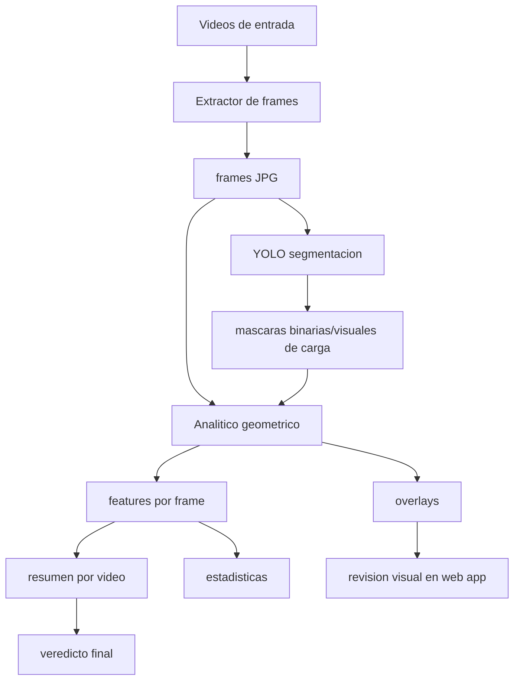

# Pipeline integrado del proyecto Cono de Carga

Este documento explica como se unieron las tres partes principales del proyecto:

1. extractor de frames desde videos,
2. modelo YOLO de segmentacion de carga visible,
3. analitico geometrico que clasifica la forma visible de la carga.

La idea central es que cada parte sigue siendo independiente. El pipeline no reescribe la logica interna de cada modulo, sino que los conecta usando carpetas y archivos intermedios bien definidos.

## Resumen corto

El pipeline completo esta orquestado por:

```text
scripts/run_pipeline_from_videos.py
```

La web app no reemplaza ese script. La web app solo:

1. recibe videos,
2. los guarda en una carpeta encapsulada,
3. arma el comando,
4. ejecuta `scripts/run_pipeline_from_videos.py`,
5. muestra consola, overlays, veredicto y tablas.

La web app llama al pipeline desde:

```text
web_app/src/pipeline_runner.py
```

## Diagrama general



## Dos niveles de integracion

### 1. Motor del pipeline

El motor real es:

```text
scripts/run_pipeline_from_videos.py
```

Este script sabe ejecutar las etapas en orden. Se puede correr desde consola o desde la web app.

Hace estas tareas:

1. valida rutas de entrada y salida,
2. crea carpetas de trabajo,
3. extrae frames desde los videos,
4. guarda manifiestos de videos y frames,
5. ejecuta localmente la inferencia de YOLO,
6. guarda mascaras generadas por YOLO,
7. llama al analitico geometrico,
8. genera `features.csv`,
9. agrega resultados por video,
10. genera `video_summary.csv`,
11. genera `pipeline_summary.json`.

### 2. Interfaz web

La interfaz esta en:

```text
web_app/
```

Su rol es operativo, no algoritmico. Permite subir videos y ver los resultados en una pantalla.

Cuando presionas `Ejecutar pipeline`, la app usa:

```text
web_app/src/pipeline_runner.py
```

Ese archivo arma un comando como:

```powershell
python scripts/run_pipeline_from_videos.py `
  --videos-dir web_app/data/uploads/<run_name>/videos `
  --run-name <run_name> `
  --work-dir web_app/outputs/runs/<run_name>/work `
  --output-dir web_app/outputs/runs/<run_name>/results `
  --interval-seconds <valor> `
  --conf <valor> `
  --device <valor> `
  --overwrite
```

La web app tambien usa ejecucion con streaming, para que la consola muestre lo que esta ocurriendo mientras el pipeline corre.

## Estructura de una corrida

En modo web app, cada corrida queda encapsulada en:

```text
web_app/
  data/
    uploads/
      <run_name>/
        videos/
          video_1.mp4
          video_2.mp4

  outputs/
    runs/
      <run_name>/
        work/
          frames/
          yolo_masks/

        results/
          analytic/
            overlays/
            tables/
              features.csv

          manifests/
            videos.csv
            frames.csv
            yolo_manifest.csv
            yolo_summary.json

          statistics/
            indicator_summary.csv
            indicator_distributions.csv

          video_summary.csv
          pipeline_summary.json
```

La carpeta `work/` contiene archivos intermedios. La carpeta `results/` contiene resultados para revision.

## Etapa 1: videos a frames

Entrada:

```text
web_app/data/uploads/<run_name>/videos/
```

Salida:

```text
web_app/outputs/runs/<run_name>/work/frames/
```

El extractor usa OpenCV dentro de `scripts/run_pipeline_from_videos.py`. Cada video se abre con `cv2.VideoCapture` y se guardan frames cada cierto intervalo.

El parametro importante es:

```text
--interval-seconds
```

Ejemplo:

- `2.0`: guarda un frame cada 2 segundos.
- `0`: intenta guardar todos los frames.

Los frames se nombran incluyendo el identificador del video:

```text
Camera_8_20240907_160001__frame000000.jpg
Camera_8_20240907_160001__frame000030.jpg
```

Esto es importante porque despues permite saber de que video viene cada frame.

Ademas se generan manifiestos:

```text
results/manifests/videos.csv
results/manifests/frames.csv
```

`frames.csv` es una tabla puente. Relaciona:

- `video_name`,
- `video_id`,
- `frame_name`,
- `frame_index`,
- `timestamp_sec`.

Esa tabla permite volver desde un resultado por frame hacia el video original.

## Etapa 2: frames a mascaras YOLO

Entrada:

```text
work/frames/
```

Salida:

```text
work/yolo_masks/
```

Esta etapa usa el modelo YOLO de segmentacion ya entrenado. No entrena un modelo nuevo en este pipeline.

El script que convierte predicciones YOLO a mascaras compatibles con el analitico es:

```text
perception/scripts/predict_to_analytic_masks.py
```

Se ejecuta con el mismo interprete Python local que inicio el pipeline:

```powershell
python perception/scripts/predict_to_analytic_masks.py ...
```

El pipeline le pasa:

- ruta del modelo `best.pt`,
- carpeta de frames,
- carpeta destino de mascaras,
- confianza YOLO,
- device GPU/CPU,
- modo de mascara.

El resultado son mascaras por frame con el mismo `stem` que la imagen:

```text
work/frames/Camera_8_20240907_160001__frame000000.jpg
work/yolo_masks/Camera_8_20240907_160001__frame000000.png
```

Ese contrato de nombres es lo que permite que el analitico encuentre la mascara correspondiente a cada imagen.

## Entorno local compartido

La web app inicia el pipeline con el Python de `web_app/.venv`. El orquestador
usa `sys.executable` para llamar a `predict_to_analytic_masks.py`, de modo que
Streamlit, PyTorch, Ultralytics, OpenCV y el analitico comparten el mismo
entorno. Las rutas se entregan directamente como rutas de Windows; no existen
conversiones a rutas de contenedor ni montajes intermedios.

Docker queda fuera del flujo operacional. Su funcion es reproducir el entorno
de preparacion, entrenamiento y validacion del modelo en `perception/`.

## Etapa 3: frames + mascaras a analitico

Entrada:

```text
work/frames/
work/yolo_masks/
```

Salida:

```text
results/analytic/
```

El pipeline llama:

```powershell
python scripts/run_simple_analytic.py `
  --images-dir work/frames `
  --masks-dir work/yolo_masks `
  --output-dir results/analytic `
  --config configs/analytic_config.yaml
```

El analitico no sabe si las mascaras vienen de CVAT manual o de YOLO. Solo necesita:

1. imagen original,
2. mascara correspondiente,
3. nombres compatibles entre imagen y mascara.

Por eso se pudo conectar despues del modelo YOLO sin modificar su logica central.

El analitico genera:

```text
results/analytic/tables/features.csv
results/analytic/overlays/
```

`features.csv` contiene las mediciones por frame:

- area de la mascara,
- bounding box,
- centroide relativo,
- pico relativo,
- simetria interna,
- irregularidad del perfil,
- cantidad de picos,
- clase preliminar,
- validez del frame.

Los overlays son imagenes para revisar visualmente:

- mascara superpuesta,
- bounding box,
- eje central,
- centroide,
- perfil superior,
- pico principal,
- clase asignada.

## Etapa 4: resultados por frame a veredicto por video

El analitico produce resultados por imagen. Pero cuando se analiza un video, se necesita un resultado agregado.

Para eso el pipeline usa:

```text
features.csv
frames.csv
videos.csv
```

La union ocurre asi:

1. `features.csv` dice que paso en cada `image_name`.
2. `frames.csv` dice de que `video_id` viene cada `image_name`.
3. El pipeline agrupa los frames por video.
4. Calcula conteos y ratios de clases.
5. Genera un veredicto final por video.

La salida es:

```text
results/video_summary.csv
```

Ese archivo resume, por video:

- cantidad de frames analizados,
- cantidad de frames validos,
- cantidad de frames no evaluables,
- ratio de frames centrados,
- ratio de frames izquierda,
- ratio de frames derecha,
- mediana de las variables geometricas principales como resumen visible,
- veredicto final,
- confianza del veredicto.

Los tres indicadores descriptivos principales son:

- `peak_x_norm`: posicion horizontal normalizada del pico visible;
- `area_symmetry`: diferencia relativa de area visible entre ambos lados;
- `centroid_x_norm`: posicion horizontal normalizada del centroide de la mascara.

El pipeline tambien escribe:

```text
results/statistics/indicator_summary.csv
results/statistics/indicator_distributions.csv
```

El primer archivo entrega P25, mediana y P75 por corrida y por video. El
segundo entrega histogramas tabulados de 20 intervalos. Solo se consideran
frames validos. Estos resultados caracterizan la forma visible de la carga,
sin interpretarlos como centro de masa real o balance fisico del camion.

Para evitar sobrecargar la presentacion, la aplicacion y el reporte visual
muestran solo la mediana con una interpretacion directa. Los percentiles y los
histogramas permanecen disponibles en los archivos anteriores.

El veredicto final puede quedar como:

```text
carga_centrada
tendencia_izquierda
tendencia_derecha
mixto_o_inestable
no_evaluable
```

## Etapa 5: resumen general de la corrida

Al final se genera:

```text
results/pipeline_summary.json
```

Este archivo guarda informacion general:

- nombre de la corrida,
- rutas de entrada y salida,
- modelo usado,
- confianza YOLO,
- device,
- cantidad de videos,
- cantidad de frames,
- resumen de features,
- conteo de veredictos.

La web app usa este JSON para mostrar metricas generales.

## Como la web app muestra los resultados

Despues de ejecutar el pipeline, la web app lee:

```text
results/video_summary.csv
results/analytic/tables/features.csv
results/analytic/overlays/
results/pipeline_summary.json
results/manifests/frames.csv
```

Con esos archivos arma la vista:

1. titulo del video activo,
2. overlays del video,
3. veredicto,
4. estadisticas,
5. resultados por frame,
6. botones de descarga.

Si hay mas de un video, la app filtra por `video_id`. Ese filtro usa `frames.csv` para saber que frames y overlays pertenecen a cada video.

## Por que esta integracion es mantenible

La integracion se hizo por contratos simples de archivos:

```text
video -> frames JPG -> mascaras PNG -> features CSV -> resumen por video
```

Esto tiene varias ventajas:

- El extractor no necesita saber como funciona YOLO.
- YOLO no necesita saber como clasifica el analitico.
- El analitico no necesita saber si la mascara viene de CVAT o de YOLO.
- La web app no necesita conocer detalles internos de OpenCV, YOLO o del analitico.
- Cada etapa puede probarse por separado.
- Si se cambia el modelo YOLO, basta con mantener el mismo formato de mascaras.
- Si se mejora el analitico, basta con mantener `features.csv` y overlays como salida.

## Que pasa si falla una etapa

La consola de la web app muestra el avance en vivo.

Las marcas principales son:

```text
[1/1] Extrayendo frames: ...
== YOLO a mascaras analiticas ==
== analitico geometrico ==
Pipeline completado
```

Si falla antes de YOLO, normalmente el problema esta en:

- videos de entrada,
- codec,
- ruta inexistente,
- permisos,
- intervalos sin frames.

Si falla en YOLO, normalmente el problema esta en:

- dependencias locales de PyTorch o Ultralytics ausentes,
- modelo de segmentacion inexistente,
- GPU/device mal configurado,
- controlador NVIDIA incompatible,
- rutas locales de frames o mascaras no disponibles.

Si falla en el analitico, normalmente el problema esta en:

- mascaras faltantes,
- nombres de frames y mascaras no coincidentes,
- mascaras vacias,
- configuracion del analitico.

## Idea central

El pipeline no es un cuarto modelo ni una mezcla de algoritmos.

Es un orquestador que toma la salida de una etapa y la convierte en la entrada esperada por la siguiente:

```text
videos
  -> frames
  -> mascaras YOLO
  -> analitico por frame
  -> veredicto por video
  -> visualizacion y descargas
```

Esa es la razon por la que el sistema puede crecer sin romperse: cada parte mantiene su responsabilidad, y el pipeline solo define el orden, las rutas y los formatos compartidos.
